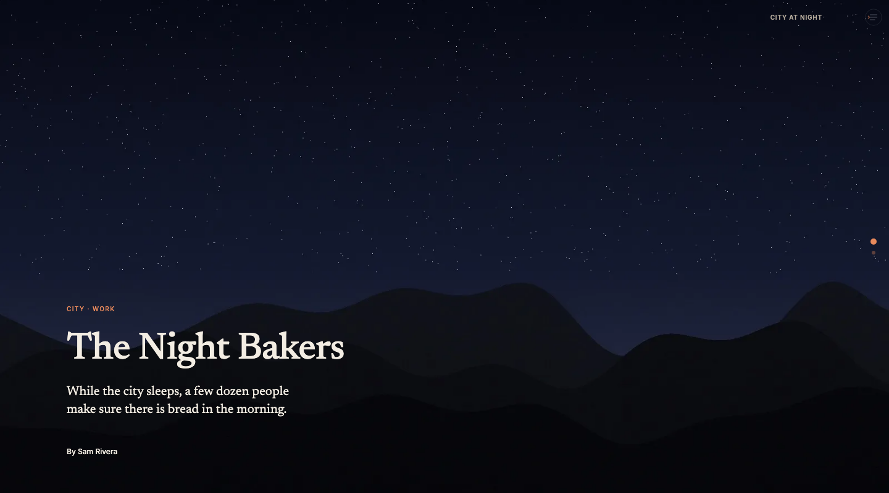
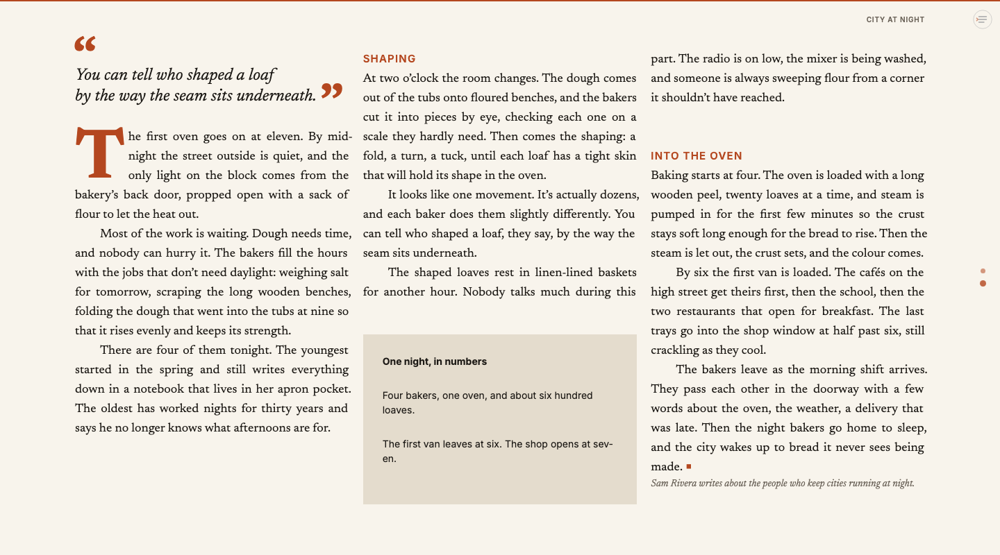
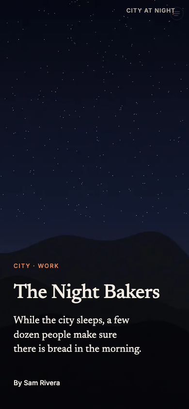
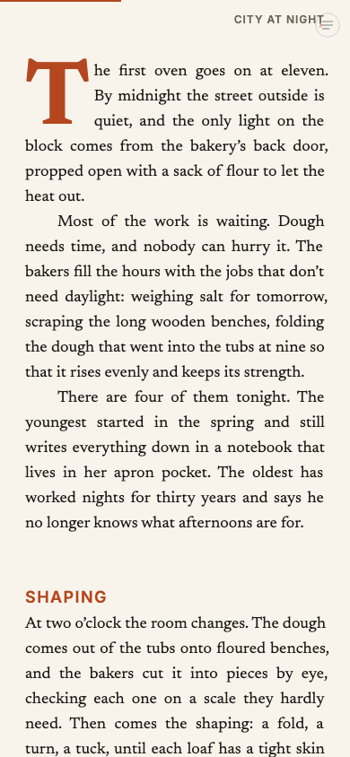
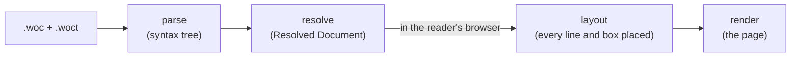

<p align="center">
  <a href="https://wocument.com">
    <picture>
      <source media="(prefers-color-scheme: dark)" srcset="docs/assets/logo-light.svg">
      
    </picture>
  </a>
</p>

<h1 align="center">Wocument Typesetter</h1>

<p align="center">
  <b>Magazine layout for the web. Write one plain text file; Wocument sets it like an editorial page, on every reader's screen.</b>
</p>

<p align="center">
  The open language and engine behind Wocument, the editorial suite for the modern web.<br>
  <i>Compile. Compose. Render.</i>
</p>

<p align="center">
  
  
  
  
</p>

<p align="center">
  <a href="https://wocument.com"><b>wocument.com</b></a> ·
  <a href="docs/README.md">Documentation</a> ·
  <a href="docs/start-here/your-first-page.md">Your first page</a> ·
  <a href="docs/reference/commands.md">Every command</a>
</p>

<br>

<p align="center">
  
  <br><sub><b>The Night Bakers</b>, the article you build in the tutorials: a full-screen opening scene, laid out by Wocument from one <code>.woc</code> file.</sub>
</p>

<p align="center">
  <a href="#the-sample-page">The sample page</a> ·
  <a href="#why-wocument">Why Wocument</a> ·
  <a href="#quick-start">Quick start</a> ·
  <a href="#what-you-write">What you write</a> ·
  <a href="#documentation">Documentation</a> ·
  <a href="#how-it-works">How it works</a> ·
  <a href="#working-on-the-engine">Working on the engine</a> ·
  <a href="#licence-and-credits">Licence and credits</a>
</p>

## The sample page

Every screen below comes from the same file, laid out by the engine for each screen size. Nothing was placed by hand. You can make it yourself in about an hour, starting with [Your first page](docs/start-here/your-first-page.md).

<table>
<tr>
<td width="62%" valign="top"><p align="center"><sub><b>A laptop.</b> Three balanced columns on one baseline grid, a pull quote and a fact box that found their own spots, and the end mark.</sub></p></td>
<td width="19%" valign="top"><p align="center"><sub><b>A phone.</b> The same opener, one screen tall.</sub></p></td>
<td width="19%" valign="top"><p align="center"><sub>Then one column that scrolls.</sub></p></td>
</tr>
</table>

## Why Wocument

Long reads on the web mostly look like blog posts: one column down the middle, pictures stacked between paragraphs. Not because nobody cares, but because nobody knows the reader's screen in advance, and no designer can place lines by hand for every size. Wocument does that work for you, in the reader's browser.

- **Magazine layout, for real.** Text in columns that share a baseline grid, threaded from frame to frame and from scene to scene. Text flows around pictures, even around the outline of a cut-out. Drop caps, pull quotes, fact boxes, running heads.
- **Every screen gets its own page.** Layout runs in the reader's browser, for their screen, and runs again when they turn their phone. Laptops get screen-tall pages of columns; phones get one comfortable column.
- **One plain text file.** The words, the pictures and the design live together in a `.woc` file you can open in any editor, keep in git and review line by line. A `.woct` theme holds a design you want to reuse.
- **Good before you design anything.** Vanilla, the built-in design, sets every page in a careful serif with balanced columns and sensible spacing. You change only what you want to.
- **It tells you what's wrong.** `woc check` catches mistakes before your readers do, from a misspelt command to colours that are too faint to read. In `woc dev`, press V for the visor: it shows the grid and explains every layout decision.
- **Publishing is plain files.** `woc build` makes a folder with one page, one script and your pictures. Put it on any host. Without JavaScript, readers still get the whole text.
- **Works with your AI assistant.** The open [Wocument Skill](skills/wocument/) teaches Claude to write, check and design pages with you. See [Design pages with Claude](docs/build/design-with-claude.md).

The idea behind it is old and simple: new underneath, familiar on top. [Read why](docs/understand/maya.md).

## Quick start

You need [Node.js](https://nodejs.org) 20 or later.

```bash
npm install --global @wocument/cli
woc dev night-bakers.woc
```

Your browser opens on the editor: the source on the left, the page on the right, laid out again as you type. When you're happy with it:

```bash
woc check night-bakers.woc
woc build night-bakers.woc --out dist
```

Upload the `dist` folder to any web host.

> **⚑ Flag:** Wocument isn't published on npm yet. Until it is, run it from this repository: `npm install`, `npm run build`, then `alias woc="node $PWD/packages/cli/dist/cli.js"`. [Install Wocument](docs/start-here/install.md#from-the-repository) has the details.

## What you write

This is a complete page:

```woc
---
wocument: 1
title: The Night Bakers
---
\kicker{City · Work}
\headline{The Night Bakers}
\deck{While the city sleeps, a few dozen people make sure there is bread in the morning.}

\dropcap[lines=3]
The first oven goes on at eleven. By midnight the street outside is quiet, and the only light on the block comes from the bakery's back door, propped open with a sack of flour to let the heat out.

Most of the work is waiting. Dough needs time, and nobody can hurry it.
```

Paragraphs are plain text. Everything else is a **command** with one shape: `\name[setting=value]{content}`. The set of commands is closed and there's no programming, so a file always reads the same way and the engine can check every line of it.

The top of the file, between the `---` lines, holds facts about the article, never its design. The design comes from Vanilla until you add your own: palettes, type styles, grids, scenes that turn as the reader scrolls, and pictures that find their own place near the paragraph they belong to.

## Documentation

The documentation lives in [`docs/`](docs/README.md), written for writers first and developers second.

| | Read this | When you want to |
| :---- | :---- | :---- |
| **Start here** | [What Wocument is](docs/start-here/what-is-wocument.md) · [Install](docs/start-here/install.md) · [Your first page](docs/start-here/your-first-page.md) | Get a page working in about twenty-five minutes |
| **Learn** | [Lay out a magazine feature](docs/learn/lay-out-a-feature.md) · [Open with a full-screen scene](docs/learn/open-with-a-scene.md) | Build a real article, step by step |
| **Build** | [Pictures](docs/build/add-pictures.md) · [Themes](docs/build/make-a-theme.md) · [Phones](docs/build/shape-the-page-for-phones.md) · [Publishing](docs/build/publish.md) · [and more](docs/README.md#build) | Do one specific thing |
| **Understand** | [Scenes, stories and frames](docs/understand/scenes-stories-frames.md) · [How pictures find their place](docs/understand/how-pictures-find-their-place.md) · [How the engine works](docs/understand/how-the-engine-works.md) | Know why it works the way it does |
| **Reference** | [Commands](docs/reference/commands.md) · [Syntax](docs/reference/syntax.md) · [Vanilla](docs/reference/vanilla.md) · [`woc`](docs/reference/cli.md) · [Warnings](docs/reference/diagnostics.md) | Look up something exactly |

The language itself is defined in two documents: [`wocument-specification.md`](wocument-specification.md) says what each construct means, and [`wocument-grammar.md`](wocument-grammar.md) says how source is parsed.

## How it works

A `.woc` file goes through four stages. The first two run once, when you build the page. The last two run in the reader's browser, because they depend on the reader's screen and fonts.



The Resolved Document in the middle is the hand-off: every value the page needs, worked out for every screen size, and nothing that depends on the actual screen. Layout measures text with the browser's own fonts, so the lines you see are the lines it computed. [How the engine works](docs/understand/how-the-engine-works.md) is the full tour.

The code is a set of small packages:

| Package | What it does |
| :---- | :---- |
| [`schema`](packages/schema) | Every command and attribute, as data. A new command is a new row, never new parser code. |
| [`parser`](packages/parser) | Reads `.woc` and `.woct` files into a syntax tree, with precise errors. Also the formatter. |
| [`resolved-document`](packages/resolved-document) | The Resolved Document's types and JSON Schema. |
| [`resolver`](packages/resolver) | Applies Vanilla, the theme and the document, and makes the Resolved Document. |
| [`assets`](packages/assets) | Picture sizes, cut-out outlines and WebP conversion, at build time. Also Vanilla's fonts. |
| [`text-engine`](packages/text-engine) | Measures and breaks text. |
| [`layout`](packages/layout) | Scenes, columns, threading, wrap, balancing and picture placement. |
| [`renderer`](packages/renderer) | Turns a laid-out page into the page the reader sees, and the reading version. |
| [`visor`](packages/visor) | Turns layout decisions into findings you can read. |
| [`cli`](packages/cli) | The `woc` command: `check`, `dev`, `build`, `format`, `parse`, `resolve`. |
| [`playground`](packages/playground) | A local editor and test bench for working on the engine. |

## Working on the engine

```bash
npm install
npm run build        # compile every package
npm test             # the test suite
npm run typecheck    # TypeScript over sources, tests and scripts
npm run playground   # the local editor at http://localhost:5190
```

Every push is checked on Node 20 and 22. The engine computes geometry only: it never calls an AI model, and the same file on the same screen, in the same browser, always gives the same page.

When you change the docs, run `node docs/_meta/check-examples.mjs`: it checks every example in them against the engine. When you change the schema, run `npm run docs:refs` to regenerate the command reference.

> **⚑ Flag:** A contribution guide, with the licence promise and how to sign off your commits, is being written. Until it's here, please open an issue before starting on a large change.

## Licence and credits

Wocument Typesetter is licensed under [Apache-2.0](LICENSE).

Vanilla's fonts, [Newsreader](packages/assets/fonts/OFL-newsreader.txt) and [Inter](packages/assets/fonts/OFL-inter.txt), ship with the engine under the SIL Open Font License.

<br>

<p align="center">
  <a href="https://wocument.com">wocument.com</a> ·
  <a href="https://x.com/wocumenthq">X</a> ·
  <a href="https://instagram.com/wocument">Instagram</a> ·
  <a href="mailto:hey@wocument.com">hey@wocument.com</a>
  <br><sub>The editorial suite for the modern web.</sub>
</p>
